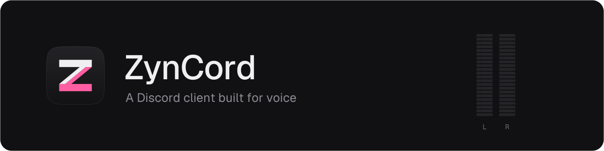
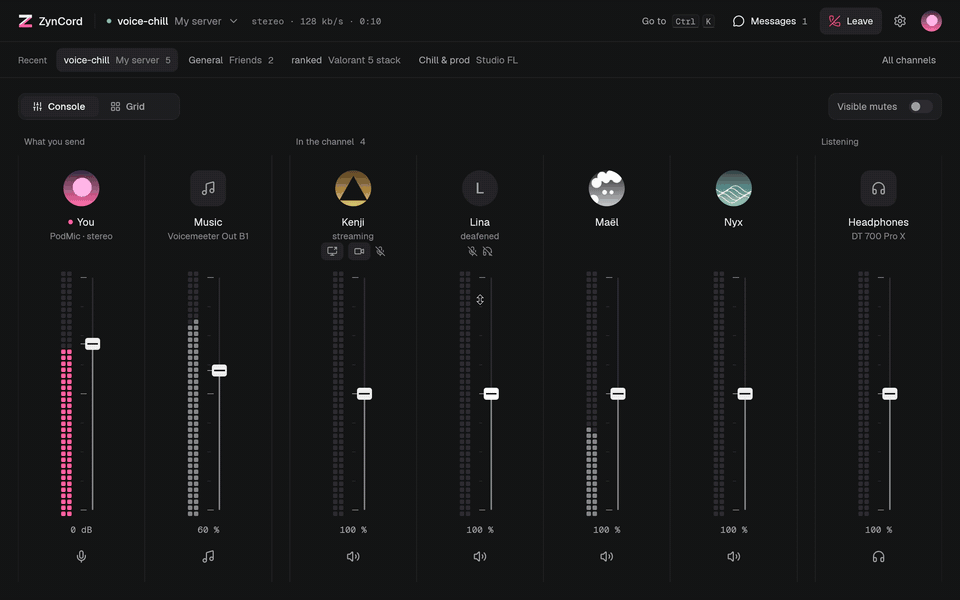
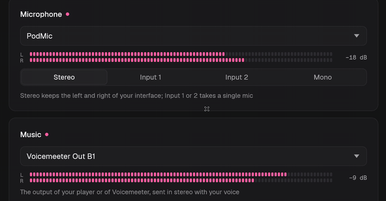
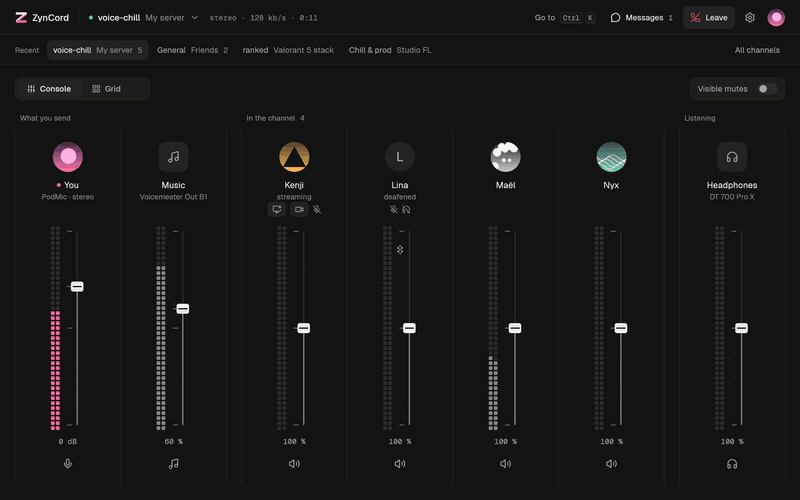

**Discord, built around the voice channel.**

A lightweight Discord client for Windows. Your mic and your music go out in stereo, and a
mixing console shows each person's left and right. DMs in a drawer, streams and cameras,
plugins and CSS themes. One exe, nothing to install.

**[Download for Windows](https://github.com/zyncord-app/zyncord-releases/releases/latest)**

> [!WARNING]
> Modified clients are against Discord's Terms of Service.
> Use a secondary account while the project is in testing.

## What it does

- **Stereo.** Your mic (in stereo, or one input of your interface) and the output of your player
  or Voicemeeter go out together, left and right kept apart. Discord's own app has sent mono only
  since 2025.
- **The console.** One strip per source, each with its left/right meter, its fader and its mute:
  what you send, one strip per person in the channel (0 to 200 %), and your headphones.
- **Console or grid.** Discord-style tiles with cameras inside and a "Watch the stream" tile per
  stream, with your voice, music and headphones kept at hand at the bottom.
- **The drawer.** DMs and groups, your voice channel's chat with its log, and friends, next to
  the console. Images, files, screenshots with Ctrl+V, stickers, reactions, replies, edits, and
  private calls.
- **Streams and cameras** in large, with the stream's sound on its own volume.
- **Profile cards.** Right-click anyone: banner, badges, bio, roles, what you have in common, a
  volume just for you.
- **Go to (Ctrl K)**: channels from all your servers, conversations and actions in one list.
- **Hear what you send.** Your voice and your music in your headphones exactly as Discord gets
  them, through the same Opus encoding. No second account to check your sound (`H`).
- **Local mutes.** By default nobody sees you muted.
- **Stays out of the way.** Close the window and stay in voice from the notification area.
  Mute and deafen shortcuts work in game.

## Getting started

1. Download `zyncord-rust.exe` from the [latest release](https://github.com/zyncord-app/zyncord-releases/releases/latest)
   and put it in a folder of its own, such as `Documents\ZynCord`. Its settings are saved next
   to it and updates replace it in place, so avoid `Program Files`.
2. The exe is not code-signed yet, so Windows SmartScreen may stop it the first time:
   **More info → Run anyway**.
3. Sign in by scanning the QR code with the Discord phone app, as on Discord's website.
   No password ever goes through ZynCord.
4. In **Settings → Sound**, pick your mic and its mode (Stereo, Input 1, Input 2, Mono), the
   device your music plays on and your headphones.
5. Join a voice channel with **Ctrl K** or from the recent channels.

## Shortcuts

| Key | Action |
|---|---|
| `Ctrl` `K` | Go to a channel, a conversation or an action |
| `Ctrl` `M` | Open or close the messages drawer |
| `M` | Mute your voice (the music keeps going) |
| `D` | Deafen |
| `B` | Mute the music |
| `H` | Hear what you send, exactly as Discord gets it |
| `F` | Full screen on a stream, `Esc` to come back |
| `Ctrl` `Shift` `M` | Mute your voice, from anywhere, even in game |
| `Ctrl` `Shift` `D` | Deafen, from anywhere |

## Themes and plugins

**Themes** are `.css` files in the `themes` folder next to the exe, picked in Settings →
Appearance and reloaded as soon as you save them. They change colours, font and layout: which
side the drawer opens on, the grid, tile shape, round or square avatars.

**Plugins** are in Settings → Plugins. The ones marked **Included** ship with every release:

- *Follow someone*: you join a person when they change channel.
- *Badges*: their Discord badges on their profile card.
- *Shown device*: computer, phone or browser next to your status.
- *Even voices*: everyone you hear at the same loudness, quiet voices up and loud ones down.
- *Now playing*: `/np` in any message sends the track you are playing, `/nplink` adds its Spotify
  link. ZynCord sends the finished message: the command never reaches Discord.

Anything else is marked **Custom**: that label comes from the app itself, a plugin cannot change it.

## Updates

ZynCord checks this repository at launch and every six hours. When a new version is out, an
**Update** button appears in the top bar with what changed; it downloads in the background and
asks you to restart.

Each release has three files:

| File | What it is |
|---|---|
| `zyncord-rust.exe` | The app, for Windows 10 and 11 |
| `zyncord-update.json` | Version, size and SHA-256 of the exe, and the release notes |
| `zyncord-update.json.sig` | The Ed25519 signature of that file |

An update is installed only if the signature matches the key built into the app and the exe
matches the signed size and hash. A changed file, a forged release or an older version is
refused. Checking can be turned off in Settings → About.

## Privacy

Your token stays on your PC, in `config.toml` next to the exe, and is only ever sent to Discord.
ZynCord talks to Discord, to GitHub to check for updates, and to `cdn.jsdelivr.net` for emoji
images. `/nplink` sends the title and artist to `api.deezer.com` and `api.song.link` to find the
link. No analytics.

---

ZynCord is not affiliated with or endorsed by Discord Inc.
